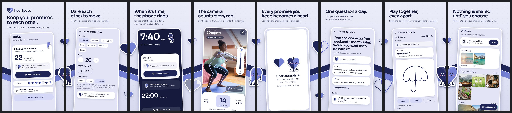

# Heartpact: Google Play listing and promotion assets



Everything the Play Console's store listing asks for, plus a promotion set, in the six languages the app speaks:
English (`en`, Play `en-US`), French (`fr`, `fr-FR`), Portuguese (`pt`, `pt-BR`), Spanish (`es`, `es-419`), Arabic (`ar`)
and Hindi (`hi`, `hi-IN`).

**Every screen is the real app.** The screenshots are the app's own Compose screens, rendered by the Android screenshot
tests (`StoreShotsTest`) in each language, with the server's own translated text (the daily question, the word to
draw). Nothing is mocked up or retouched. The art on the page (the two-tone hearts, Maya and Theo, the logo) is the
app's own drawing code too (`StoreArtTest`), and the Play icon is drawn from the launcher's own icon layers.

- **Camera:** the camera screen shows a real photo where the front camera's picture goes. The body points on it are what
  the app's own pose model (`pose_landmarker_lite.task`) found on that photo. The photo fills the camera area the way a
  camera preview does (cropped, never stretched), and the points move with it.
- **Album and food:** they show the licensed stand-in photos from `design/heartpact-v3/assets` (Unsplash and Pexels
  licences: free for commercial use, no attribution needed; see `PROVENANCE.json`).
- **People:** names are the app's sample couple, Maya and Theo.
- **Nothing invented:** no reviews, ratings, install counts or prices.

## Upload (Play Console → Grow → Store presence → Main store listing)

Add each language as a translation (Manage translations) and upload that language's files.

| Console field | File | Spec it meets |
| --- | --- | --- |
| App icon | `icon/heartpact-play-icon-512.png` | 512 × 512, 32-bit PNG, full square and opaque (Play rounds the corners). Same layers as the launcher icon. |
| Feature graphic | `feature-graphic/<lang>/feature-graphic-1024x500.png` | 1024 × 500, 24-bit PNG, no alpha. No app icon in it (Play asks not to repeat it); the words sit clear of the edges. |
| Phone screenshots | `screenshots/phone/<lang>/01-…` to `08-…`, **in this order** | 8 × 1080 × 1920 JPEG (9:16), under 8 MB each. Eight is Play's maximum, and four or more at 1080 px qualify for promotion. |
| 7-inch tablet screenshots | `screenshots/tablet7/<lang>/01-…` to `05-…` | 5 × 1920 × 1080 JPEG (16:9), from screens rendered on a 7-inch tablet lying down (960 × 600 dp). |
| 10-inch tablet screenshots | `screenshots/tablet10/<lang>/01-…` to `05-…` | 5 × 2560 × 1440 JPEG (16:9), from screens rendered on a 10-inch tablet lying down (1280 × 800 dp). |
| App name | `listing/<lang>/title.txt` | ≤ 30 characters |
| Short description | `listing/<lang>/short-description.txt` | ≤ 80 |
| Full description | `listing/<lang>/full-description.txt` | ≤ 4,000 |
| Release notes (Releases → your release) | `listing/<lang>/release-notes.txt` | ≤ 500 |

**The phone screenshots are one panorama: upload them in order.** Each is a slice of one 8640 × 1920 picture. The
ribbon and the hearts and characters on every join run from one into the next, so the carousel reads as one long
album page. Each still works alone, because every caption and screen sits wholly inside its own slice.

**Arabic runs the other way.** Play shows an Arabic listing's screenshots right to left, so the Arabic panorama is laid
out mirrored. Upload `01` to `08` as numbered, and `01` (the hero) lands on the right. The previews show each language as
it will look: `previews/phone-panorama-<lang>.jpg`.

| # | Caption (English) | Real screen |
| --- | --- | --- |
| 01 | Keep your promises to each other. | Today: a dare ringing, the week's hearts |
| 02 | Dare each other to move. | New dare for Theo |
| 03 | When it's time, the phone rings. | The alarm |
| 04 | The camera counts every rep. | Squats on camera, 14 of 20 |
| 05 | Every promise you keep becomes a heart. | Heart complete |
| 06 | One question a day. | Today's question, both answered |
| 07 | Play together, even apart. | Draw and guess |
| 08 | Nothing is shared until you choose. | Album: photos waiting on this phone until Sync |

Captions are in `tools/captions.json`. Where the app already says it ("Keep your promises to each other.", "Dare each
other to move.", "Every promise you keep becomes a heart.", "Nothing is shared until you choose."), each language uses
the app's own translation word for word.

**Tablets.** The app has a tablet layout (`android/README.md`, Tablets): a navigation rail, two panes on Today, Food
and Us, the games and the album in columns. The tablet sets show it lying down: Today, Food, Today's question, the games
and the album.

### Checked against Play's rules

- **Screenshots:** the real in-app experience, with no device frames and no hands holding a device. Each caption covers
  under 20 % of its image; the build checks this, and also checks that every caption stays inside its own slice.
- **Wording:** nothing like "Free", "Best", "#1", "Top", "New" or "Download now", no prices or promotions, and nothing
  time-limited. `python3 tools/build.py check` checks the English listing for these and every language for length.
- **Claims:** every claim matches the app (`PRODUCT.md`):
  - Food estimates are ranges.
  - Cycle predictions are estimates, not medical advice.
  - Location is only ever shared both ways and can be paused.
  - The alarm can always be silenced on the phone.
- **Icon:** no text and no badges.

## Logo (`logo/`)

| File | What |
| --- | --- |
| `heartpact-mark.svg`, `heartpact-mark.png` | The mark for light grounds: indigo and periwinkle halves. Vector, and a large PNG on transparent ground. |
| `heartpact-mark-on-dark.svg`, `heartpact-mark-on-dark.png` | The mark for dark grounds: the left half turns white. |
| `heartpact-lockup.png` | Mark and wordmark ("heartpact" in Sora, as in the app) for light grounds, transparent. |
| `heartpact-lockup-on-dark.png` | The same for dark grounds. |
| `heartpact-app-icon-1024.png`, `heartpact-app-icon-512.png` | The app icon, full square: profile pictures, press, the website. Play rounds the corners itself. |
| `app-icon-background.svg`, `app-icon-foreground.svg`, `app-icon-monochrome.svg` | The launcher icon's layers (108 × 108, safe zone in the middle 66). |

Keep the mark's two halves in their colours and order; don't stretch it, add effects or put it on a busy picture.

## Promotion (`promo/<lang>/`)

Each uses Google's official "Get it on Google Play" badge in that language (`tools/badges/`, unaltered, from
play.google.com/intl/en_us/badges). Google's brand rules ask for the badge at a readable size, unchanged, and never
in the app's own Play listing.

| File | Size | For |
| --- | --- | --- |
| `post-1-today-1080x1350.jpg` … `post-4-games-draw-1080x1350.jpg` | 1080 × 1350 (4:5) | Instagram and Facebook feed posts, or a carousel |
| `story-1080x1920.jpg` | 1080 × 1920 (9:16) | Instagram and Facebook stories, WhatsApp status, TikTok. Text and badge stay inside the safe area (250 px top, 340 px bottom). |
| `x-1600x900.jpg` | 1600 × 900 (16:9) | X / Twitter, LinkedIn and Facebook posts |
| `link-preview-1200x630.jpg` | 1200 × 630 | Link previews (Open Graph): the website, WhatsApp, Facebook, LinkedIn, Slack |

Add `https://play.google.com/store/apps/details?id=app.heartpact` to the posts once the listing is live.

## Before you submit

- **Privacy policy:** https://heartpact.app/privacy/ (required), and the account deletion page
  https://heartpact.app/delete-account/. The terms are at https://heartpact.app/terms/. The app links to both
  (sign-up, and Us → Privacy policy / Terms of use). Every placeholder is filled in (HeartPact, Delaware; Railway US East; Resend;
  audit log 2 years, backups and logs 30 days; US$100 liability cap). Have a lawyer read them before launch.
- **Contact:** support@heartpact.app, and the website https://heartpact.app.
- **Category:** Lifestyle, or Health & Fitness. Tags: Couples, Relationships, Fitness, Habits.
- **Data safety form:** account details (name, email, date of birth, gender, country), photos (album, food), location
  (map, only while both share), health (cycle, pregnancy, workouts) and the camera. The camera picture is analysed on
  the phone for rep counting.
- **Permissions declarations:**
  - exact alarms (`SCHEDULE_EXACT_ALARM`, the dare alarm);
  - full-screen intents (`USE_FULL_SCREEN_INTENT`, the ringing alarm);
  - camera;
  - location, including the location foreground service (`FOREGROUND_SERVICE_LOCATION`), whose declaration asks for
    a short video of the feature in use.

  Describe location as mutual, visible and pausable, never "find your partner" (Play's stalkerware policy).
- **Health apps declaration:** the cycle and pregnancy features.
- **Promo video:** optional. Play takes a YouTube link: upload `../video/heartpact-launch-16x9.mp4` (see
  `marketing/video/README.md`) to YouTube, unlisted or public, with ads turned off, and paste its URL.

## Rebuild

```bash
# 1. The real screens and the app's art (android/app/build/screens/store*)
cd android
./gradlew testDebugUnitTest --tests '*StoreShotsTest*' --tests '*StoreArtTest*' -Proborazzi.test.record=true
cd ..

# 2. Everything in this folder (needs Python 3 with Pillow, and Node with Playwright and Chromium)
python3 marketing/play-store/tools/build.py          # all languages, or e.g.: build.py en fr
python3 marketing/play-store/tools/build.py check    # listing lengths and wording
```

| Piece | Where |
| --- | --- |
| Screens, per language and tablet size | `android/app/src/test/java/app/heartpact/screens/StoreShotsTest.kt` (photos in `android/app/src/test/resources/store/`) |
| The app's art and the Play icon | `android/app/src/test/java/app/heartpact/screens/StoreArtTest.kt` |
| Layouts: panorama, feature graphic, tablets, promotion | `tools/build.py` (HTML rendered by `tools/render.cjs` in Chromium) |
| Captions | `tools/captions.json` |
| Fonts | `tools/fonts/`: Sora and Figtree as in the app, Noto Sans Arabic and Devanagari for captions (all SIL Open Font License) |
